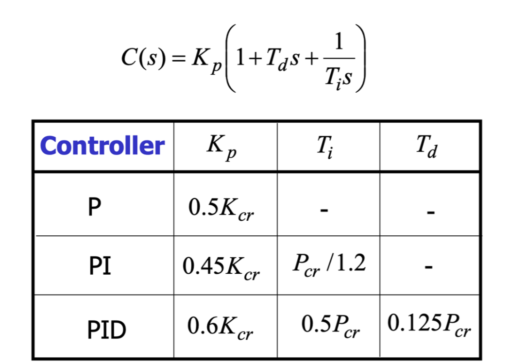

## Code

### Procedure


#### Excercise 1
Modify the P-control lab code so that the input *u(t)* is a sine wave instead of a step input. Use a amplitude of *250 counts* and a frequency of *5 Hz* `250*sin(2*pi*5*t)`. 


## Ziegler Nichol Method


## Mode 0: Test Sin Input
- Create array of values for oscillation
`[4, 8, 10, 12, 14, 16, 20]` Hz
- Find input output ratio to find dB
- Construct Bode plot
- Estimage bandwidth by finding corner frequency.
- Compare experiemental and analytical bandwidths of closed-loop control.


## Mode 1: P Control
- u(t) = STEP (setpoint: 500)
- Only Kp

## Mode 2: PI Control
- u(t) = STEP (setpoint: 500)
- Only Kp, Ki

## Mode 3: PID Control 
- u(t) = STEP (setpoint: 500)
- Kp, Ki, and Kd


## Code Helper Funcs
### dispInfo
Show the following data:
- Type of control
- Kp
- Ki
- Kd

### stepTest()
`stepInput(setpoiont, kp, ki, kd)`

```
Info:
kp = __
ki = __
kd = __

Running 'PID' control

Running test in 3
2
1

File saved to 'data/PID_2.5'

Press H to continue
```


